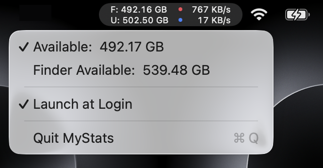

[中文](README.zh-CN.md)


# MyStats

A lightweight, native macOS menu bar application to monitor Disk and Network usage.



## Features
- **Disk Usage**: Shows free and used disk space in GB (two-row layout).
- **Network Speed**: Shows real-time upload/download speeds, auto-scaling between B/s, KB/s, and MB/s.
- **Minimalist**: Uses native Swift and AppKit for maximum performance and minimum footprint.
- **Settings**: Simple "Launch at Login" option.

## Requirements
- macOS 13 (Ventura) or later
- Xcode Command Line Tools (for building from source)

## Installation

### Option A: Git Clone

```bash
git clone https://github.com/Humsweet/MyStats.git
cd MyStats
```

### Option B: Download ZIP

Click the green **Code** button on this page → **Download ZIP**, then unzip and `cd` into the folder.

### Build

If you don't have Xcode Command Line Tools installed yet:

```bash
xcode-select --install
```

Then build the app:

```bash
chmod +x scripts/build_app.sh
./scripts/build_app.sh
```

Once you see `Done. App is at .../MyStats.app`, the build is complete.

### Run

Move `MyStats.app` to `/Applications` and double-click to launch.

> **Note**: Moving to `/Applications` is required for "Launch at Login" to work correctly due to macOS security restrictions.

## Usage
The status bar item displays a compact two-row view:

```
F: 179.89 GB  ● 512 KB/s
U: 300.11 GB  ● 128 KB/s
```

- Top row: Free disk space (F:) + upload speed (red dot indicator)
- Bottom row: Used disk space (U:) + download speed (blue dot indicator)
- Click the item to open the dropdown menu, which lets you switch the free-space mode ("Available" vs "Finder Available"), toggle "Launch at Login", or quit the app.

## Technical Details
- Built with Swift 5.9, targeting macOS 13+.
- Uses `getifaddrs` for network monitoring (low-level BSD socket API), excluding loopback interfaces.
- Uses `SMAppService` for modern login item management.
- Updates every 1 second via a `Timer` on the main run loop.

## Credits
- App icon glyph: the `gauge` icon from [lucide](https://lucide.dev), ISC licence.
